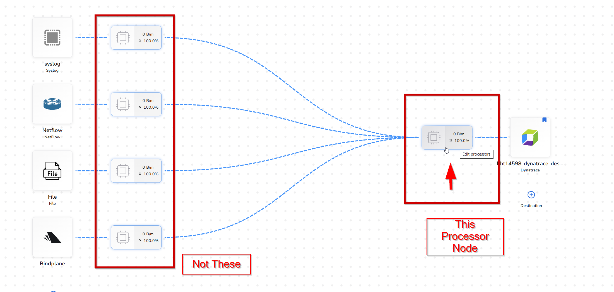
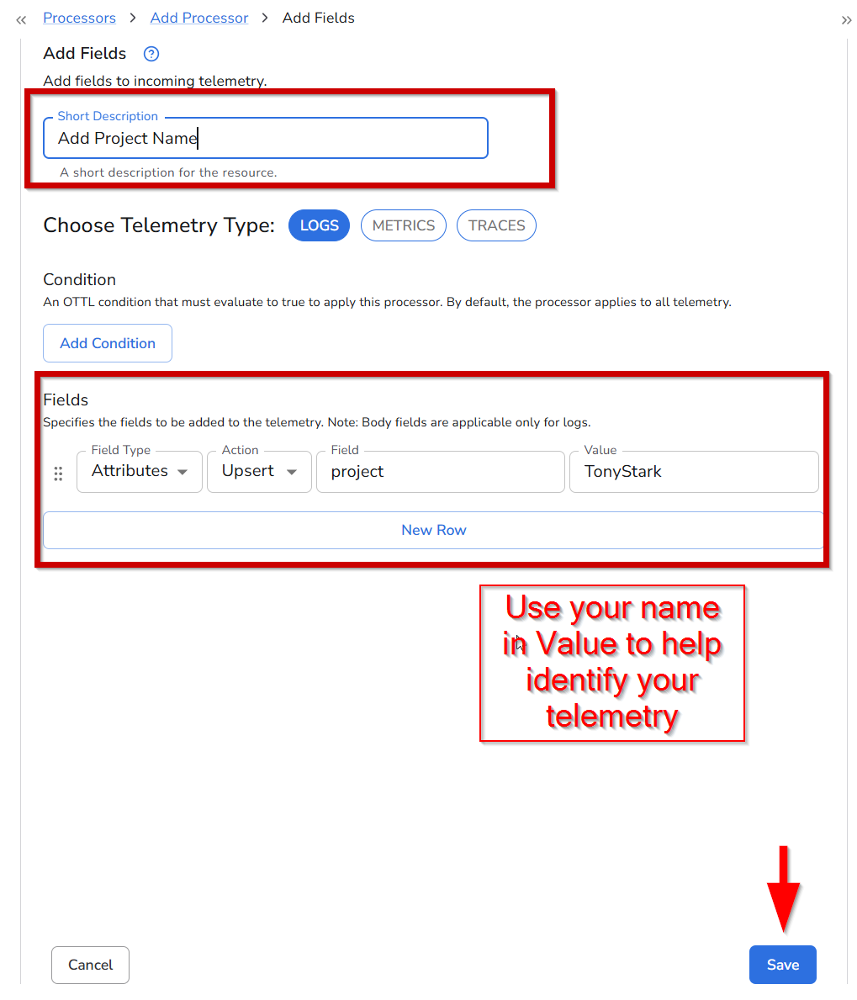
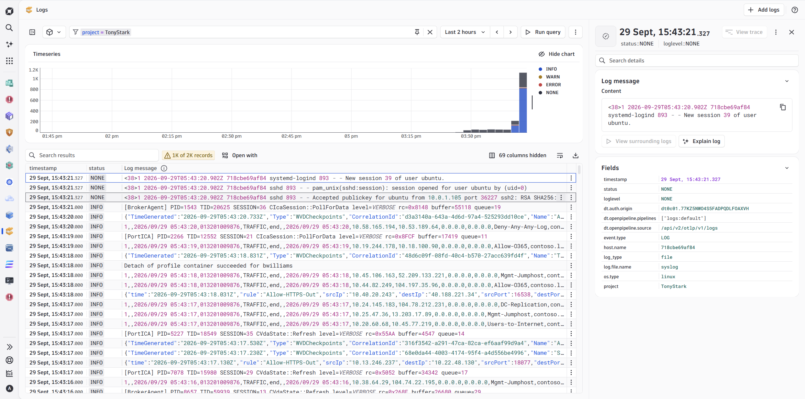

When your logs reach Dynatrace, they're mixed in with every other source in the environment. A **processor** fixes that: it sits between your sources and the destination and transforms records in flight, before they leave your host.

**Add Fields** is the simplest one. It stamps a key-value attribute onto every record that passes through. You'll add it to the **processor node in front of the Dynatrace destination**, so logs from every source (file, syslog, NetFlow and the collector itself) get the same label. If you ever want a different label per source, you could add it on that source's node instead (not part of this lab).

Bindplane's live preview shows each record **before** and **after** the processor, using real data from your collector, so you can check the result before you roll it out.

You will be adding `project: <yourname>` (for example `project: TonyStark`). Use the same value everywhere in the lab: it's the key you'll filter on in Dynatrace, route on in OpenPipeline, and use in every query that follows. Use your name so we can identify and give prizes if you complete all the tasks first.

Now, if you search for logs in Dynatrace you will see logs from every other source:


Let's use a Bindplane processor to help us sort this out.

### 1. Open the Processors Configuration
Beginning at you logs pipeline configuration, click on the processor configuration node for the Syslog file source.



### 2. View and Compare Live Logs
Here we can see a live preview of the logs that are passing through this node.  This will allow us to test and debug parsers with live data before we apply our changes!

Click on one of the incoming log messages on the left, and the corresponding outgoing log will automatically expand on the right.  (Of course, they will be identical, because we don't have any processors configured yet)


Click "Add Processor" and continue to the next step.

### 3. Find the "Add Fields" Transform Processor

Search for "Add Fields" in the search box, and find the result "Add Fields", which is a **Transform** type processor


Click on the processor name to begin configuring it.

### 4. Configure the Add Fields Processor
We are going to add a field to all logs used in this lab so that they are easily filterable in Dynatrace.

1. Add the Short Description "Add Project Name"
2. For the field itself, use `project` for the field name, and `<yourname>` for the field value &mdash; `TonyStark` is the example used throughout this lab. Keep the defaults for the other values.
!!! info "A Unified Telemetry Pipeline Built on OpenTelemetry"
    Because Bindplane manages OpenTelemetry components, our Add Field follows the [OpenTelemetry Specification](https://opentelemetry.io/docs/specs/otel/logs/data-model/#log-and-event-record-definition), which you may recognize.  We can change the field type to a Resource field, or the Body of the message altogther, as well as the attribute type we're adding here.  We can also choose how to modify the record: Insert, Update or Upsert.


3. Click "Save", and let's preview our changes

### 5. Preview Changes

Now we're back to our processor node configuration.  We can see that our processor has been added.  Expand one of the logs messages on the left.  We can see what our log message would look like if passed through this node, with our new field!

Notice as well that Bindplane has enriched our logs by adding some fields such as the `log_type` as well as some [OpenTelemetry Resource](https://opentelemetry.io/docs/concepts/resources/) attributes.


Click the "Save" button at the bottom.  We had previously saved our changes to the individual processor that we created.  This will save *all* changes made to this processor node (if we added or edited multiple processors, for example).

### 6. Rollout to the Agent
We're back at our configuration and we can see that our processor node is indicating that we have one processor now.  But also notice that we're prompted to "Start Rollout" and that we are currently viewing a draft version of our configuration.

<!--  -->

Even though we've saved our changes to the configuration itself, the final step is to roll it out to the agents that use it (in our case, the single agent we added).

Go ahead and click "Start Rollout" to push this change to the agent.

!!! tip "Infrastructure as Code"
    Notice the "Compare" button next to "Start Rollout".  Clicking it will show you the underlying declarative YAML that is used to construct your configuration.

### 7. Filtering in Dynatrace
Once the rollout is complete, switch to your Dynatrace environment 

- Search for the `logs` app in Dynatrace
- In the FILTER bar, type `project` as a key
- Select `=` and then wait for your project name(your name) to appear and select your name
- Cick "Run Query" to fetch the latest logs.

Click on one of the Syslog logs and see the detailed view on the right side of the window.  There's our added field!  Now we can use it to filter for any logs coming from this lab.



#### 8. Searching using Dynatrace Notebooks
- Search for the `Notebooks` app in Dynatrace
- Create a `New Notebook`
- Give it a name if you like
- Click the `+` button and then select `DQL`
- Paste the following query and hit the `Run` button.
- Don't forget to change `TonyStark` to your name!

```
fetch logs
| filter matchesValue(project, "TonyStark")
```


Search for the log searches under your project

- Click the `+` button and then select `DQL`
- Paste the following query and hit the `Run` button.
- Don't forget to change `TonyStark` to your name!

You are now summarizing all the logs based on the log.file.name

```
fetch logs
| filter matchesValue(project, "TonyStark")
| summarize count = count(), by:{log.file.name}
``` 
Perfect!  Now we can focus on exactly what we need to.  Think about how you'd use this feature with the logs you currently collect.

