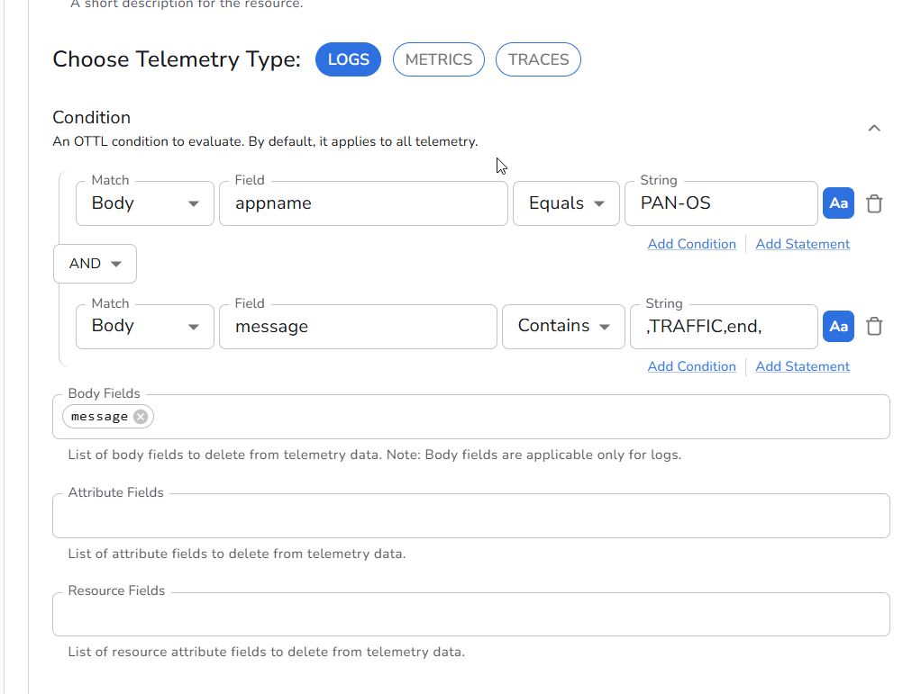
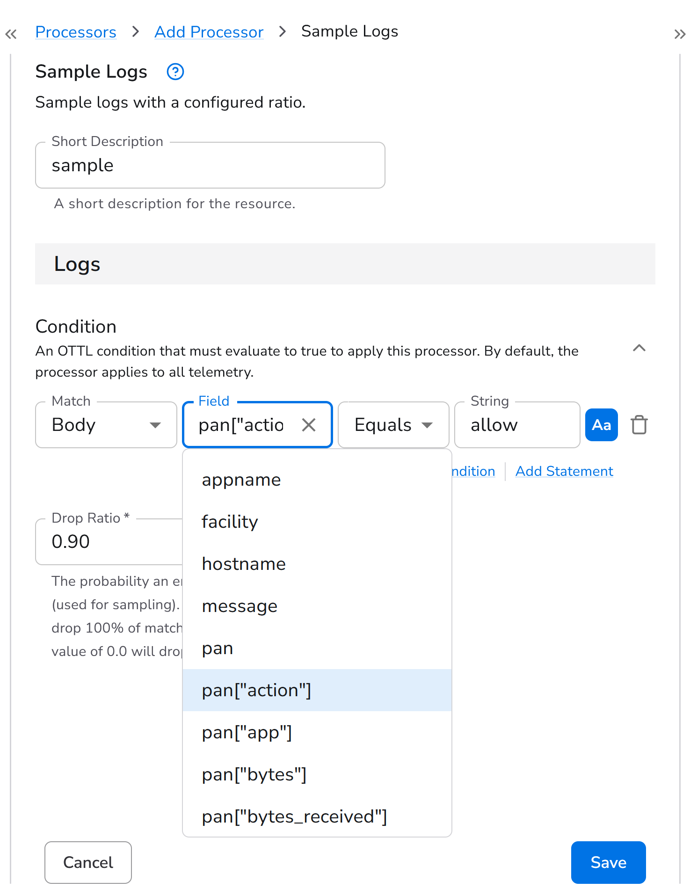

# Volume Reduction

## The problem

Firewall traffic logs are among the highest-volume sources in most environments, and most records are routine. In this lab's mock environment, about 92 percent of PAN-OS TRAFFIC records are permitted sessions that ended normally (`tcp-fin`, `aged-out`). The remaining 8 percent — sessions with `deny`, `drop`, or `reset-both` — are the ones needed for investigations and must arrive complete.

Parsing has also added redundancy: each record now carries both the original CSV string in `body.message` and the same values as named fields.

This section addresses both, in order:

1. **Remove the raw message.** Drop `body.message` now that its contents are parsed.
2. **Sample routine traffic.** Forward all denied, dropped, and reset sessions in full, and sample permitted sessions at a ratio you choose.

Reducing volume in the pipeline lowers network, storage, and query costs at every destination, especially ingest-priced SIEM platforms, where firewall logs are often a major licensing cost. Because only routine traffic is sampled, security analysis is unaffected.

## Removing the raw message

### Add another processor to your Syslog source

- Click on `Edit processors` next to the `syslog` source. It should show **1** to indicate it already has one processor.
- Click on `Add processor`.
- Search for **Delete Fields** and select it. Set the telemetry type to **Logs**.
- Enter a short description: `Delete body.message`
- Add these two conditions (the same ones defined in the previous section):

| Match | Field | Operator | String |
|---|---|---|---|
| Body | `appname` | Equals | `PAN-OS` |
| Body | `message` | Contains | `,TRAFFIC,end,` |

!!! danger "The second condition is CONTAINS, not EQUALS"
    Make sure you select **Contains** for the condition that matches the text `,TRAFFIC,end,`

Screenshot of the conditions:

- Click inside `Body Fields` and select `message`. This means that when the above conditions are met, the `message` field inside `body` will be dropped.

Screenshot showing that the `message` field will be deleted:

## Sampling permitted traffic

- Add another processor to the existing two processors.
- Search for **Sample Logs** and select it.
- Enter a short description: `Sample allow traffic`
- Click on **Add Condition**.
- Set Match to `Body`.
- Click inside Field and select `pan["action"]`.
- Set Condition to `Equals` (default).
- Click inside String and select `allow`.
- Set Drop Ratio to `0.9`.

| Drop Ratio | Percentage forwarded |
|---|---|
| `0.9` | 10% |
| `0.8` | 20% |
| `0.5` | 50% |

Validate within Bindplane before saving to see the volume reduction:

!!! tip "Rollout"
    Don't forget to rollout the change the collectors